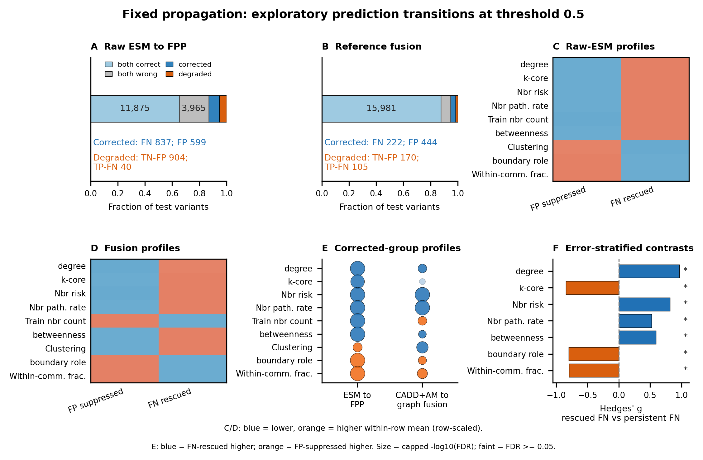
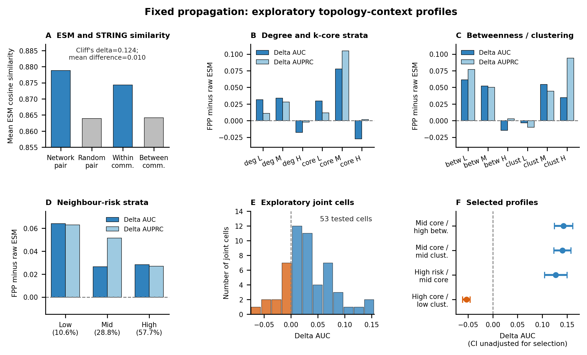

# Supplementary Information

Title: Auditing PPI Graph Augmentation for Missense Variant Pathogenicity Prediction under Topology, Connectivity and Homology Constraints

Authors: Yuxin Tian, Xianguo Zhang (corresponding author), Weibo Meng, Jieqi Yin and Yongqin Jin.

Affiliation (all authors): College of Computer Science (College of Software), College of Artificial Intelligence, Inner Mongolia University, Hohhot 010021, China.

First-author email: yuxin_t02@163.com. Corresponding-author email: 2595083628@qq.com.

## Notes on scope

This Supplementary Information provides reconstruction details, split statistics, model comparisons, uncertainty estimates, topology-stratified summaries and negative-control results. Full figure source data, topology-stratified metrics, corrected-sample statistics and fusion-control summaries are included in the prepared compact source-data archive.

Status guide: Tables 2–4 and 8–10 preserve historical results. Current matched results are in Tables 11–13, with the restored runtime and corrected common propagation operator documented in Methods 5. External-source and BioGRID validation are documented in Methods 6 and Tables 14–17. Historical comparisons must not be substituted for the current estimates. The earlier main topology figure is Supplementary Figure S2.

## Supplementary Methods

### Supplementary Methods 1. Dataset reconstruction and source files

We reconstructed a missense variant pathogenicity dataset from the ClinVar `variant_summary.txt.gz` table obtained from the official NCBI ClinVar FTP `tab_delimited` directory. The present analysis uses retained, checksum-identified processed tables and model inputs. Their exact historical ClinVar content-release date is unverified: a retained raw-file copy contains 2026 LastEvaluated records, but its relationship to the earlier processed tables has not been independently established. We therefore do not assign 31 March 2024, or a replacement 2026 date, to the frozen benchmark. Checksums and verified row identities identify the evaluated inputs; they do not establish temporal independence. We retained germline GRCh38 single-nucleotide variant records and extracted protein-level HGVS annotations. Missense substitutions were identified using a strict three-letter amino-acid substitution pattern.

Pathogenic, Likely pathogenic and Pathogenic/Likely pathogenic records were grouped as pathogenic. Benign, Likely benign and Benign/Likely benign records were grouped as benign. Supported review status was defined as the exact ClinVar `ReviewStatus` strings `criteria provided, single submitter`, `criteria provided, multiple submitters, no conflicts`, `reviewed by expert panel`, and `practice guideline`; records outside this whitelist were excluded. Conflicting VariationIDs were removed, and duplicate VariationIDs were collapsed after conflict removal. The final mapped dataset contained 177,213 filtered, non-conflicting ClinVar missense variants with criteria-supported review status, including 127,953 benign and 49,260 pathogenic variants.

ClinVar gene symbols were mapped to STRING human protein nodes using upper-cased gene symbols and the STRING protein alias table. Only genes that mapped uniquely to a STRING protein present in the STRING links graph were retained. Mapping was performed at the protein-identifier level; isoform-specific effects and transcript-level ambiguity were not modeled separately. The reconstructed ClinVar-STRING dataset covered 14,123 unique variant-labelled STRING proteins embedded in a larger STRING node universe containing 19,622 proteins. The final variant tables retained genomic coordinates, reference and alternate VCF alleles, VariationID, binary label, gene symbol and mapped STRING protein identifier.

CADD and AlphaMissense scores were matched to ClinVar variants by GRCh38 genomic coordinates and reference/alternate alleles. CADD GRCh38 v1.7 whole-genome SNV scores were matched for 177,205 of 177,213 variants, leaving eight missing CADD rows. AlphaMissense hg38 scores were matched for 171,753 variants, leaving 5,460 missing AlphaMissense rows. CADD-only and AlphaMissense-only baselines used their corresponding matched scalar scores. CADD+AlphaMissense models used CADD PHRED, AlphaMissense pathogenicity and an AlphaMissense-missing indicator. Raw-ESM fusion concatenated these scalar features with the 1,280-dimensional raw ESM protein representation, whereas graph-fusion models concatenated the same scalar features with the 1,280-dimensional FPP representation. Follow-up graph-control fusions used the same scalar CADD+AlphaMissense features concatenated with real FPP, direct train-test edge-ablated FPP, or topology-permuted FPP representations.

### Supplementary Methods 2. Protein representations and graph propagation

Protein node features were generated with the Facebook ESM-2 t33 650M UR50D checkpoint. Residue-level embeddings were mean-pooled to obtain one 1,280-dimensional vector per protein. Proteins longer than 1,022 amino acids were split into chunks and combined by length-weighted averaging. The final feature table covered all 19,622 STRING graph proteins, with no missing graph proteins.

The primary representation-propagation graph was built from STRING v12 human protein links and contained 19,622 nodes and 13,715,404 directed edge-index entries in the retained model input object before adding self-loops. FPP representations were generated using fixed two-hop GCN-style propagation rather than an end-to-end trainable graph neural network. This design intentionally isolated topology-induced smoothing from capacity gains due to trainable graph layers, so the propagated features were treated as a controlled representation rather than an optimized end-to-end GNN predictor. Propagation used a binary adjacency derived from the retained edge list; STRING combined scores were not used as propagation weights. For the historical full FPP and all current matched graph arms, self-loops are added before symmetrization: $A=(E+I)+(E+I)^T$, retaining summed edge-count multiplicities after coalescing. Here $E$ is the edge-index count matrix, $D$ is the weighted degree matrix and $X$ is the raw ESM feature matrix. Old ablation/permutation controls instead added a single loop after reverse edges. Their outputs remain historical; new matched controls correct this convention mismatch. We used symmetric normalization,

$$
\hat{A}=D^{-\frac{1}{2}} A D^{-\frac{1}{2}},
$$

and formed the propagated representation as

$$
H=\frac{1}{3}\left(X+\hat{A}X+\hat{A}^{2}X\right).
$$

FPP denotes fixed protein-feature propagation. This operation produced one propagated representation per STRING node and did not use variant labels during propagation. The full graph includes held-out features and nodes: this is transductive feature access, not use of held-out labels. All embedding-only variant inputs are identical within each mapped protein.

Two supplementary fixed operators were used: row-normalized two-hop mean propagation with residual averaging, and two rounds of cosine-softmax-weighted neighbour aggregation with residual averaging. The code runs both under no-gradient computation and has no learned aggregation or attention parameters. The original labels "GraphSAGE-style" and "GAT-style" are replaced by "Fixed mean propagation" and "Fixed cosine-weighted propagation". These are operator controls, not trained GraphSAGE/GAT baselines. The cosine operator includes self-neighbours and softmax weights from the current feature cosine similarity; trained graph models were not evaluated.

For topology profiling, we used a separate thresholded STRING graph based on combined score. The primary topology analyses used a combined-score threshold of 400, yielding 19,622 nodes and 929,472 graph edges. Degree, k-core, community membership, betweenness, clustering coefficient and community-boundary role were computed on this thresholded graph. The representation-propagation graph and the topology-description graph were related STRING-derived objects but not identical analysis objects.

For topology-permutation controls, the graph edges were relabelled by a random node permutation (`edge_index_perm = perm[edge_index]`), while ESM features, labels and train/validation/test variant assignments remained tied to the original protein identities. Variant features were then extracted from the propagated representation of each variant's original mapped STRING protein after propagation on the permuted graph. The graph edge count and unlabeled topology were preserved, but the original protein-to-neighbourhood correspondence was broken. Three graph permutations were combined with three downstream classifier seeds, and the downstream MLP was retrained for each permutation/seed pair.

### Supplementary Methods 3. Evaluation splits, homology-aware stress test and statistical analysis

The original evaluation split was constructed at the STRING protein level using seed 42 and an approximate 8:1:1 train, validation and test ratio. Variants assigned to the same STRING protein were kept in the same partition. This produced 141,864 training variants, 17,129 validation variants and 18,220 test variants, with no shared proteins across partitions. The corresponding numbers of unique proteins were 11,298, 1,412 and 1,413 in the train, validation and test sets. All proteins remained embedded in the same full STRING association graph, so train and test proteins could still be connected through STRING edges.

For homology-aware evaluation, STRING v12 human protein sequences were clustered with MMseqs using minimum sequence identity 0.40, coverage threshold 0.50 and cov-mode 0. Homologous clusters rather than individual proteins were assigned to train, validation and test partitions, with no protein or homology-cluster overlap across partitions. This split was used as a stricter stress test for reduced sequence-related sharing across partitions, not as a prevalence-matched replacement for the original protein-level split. It preserved the original row counts: 141,864 training variants, 17,129 validation variants and 18,220 test variants. The homology-aware split contained 7,370, 3,315 and 3,438 unique proteins in the train, validation and test sets, respectively, and was built from 9,731 protein clusters with mean cluster size 1.45 and maximum cluster size 251. Because test prevalence changed from 31.95% in the original split to 10.56% in the homology-aware split, AUPRC values should be interpreted within each split rather than directly compared across splits. Protein-cluster assignment sorted clusters by descending variant-row count and greedily chose the partition with largest remaining target capacity (tie order: train, validation, test), without class-prevalence stratification. The implemented commands are:

```text
mmseqs createdb all_split_proteins.fa split_proteins_db
mmseqs cluster split_proteins_db split_proteins_clu tmp --min-seq-id 0.40 -c 0.50 --cov-mode 0 --threads 8
mmseqs createtsv split_proteins_db split_proteins_db split_proteins_clu split_proteins_cluster.tsv
```

The retained script does not pin the MMseqs binary version or non-overridden defaults; exact regeneration remains dependent on that historical environment. Cluster-disjointness under these parameters is not a guarantee that every distant homolog is separated. Historical single-run fusion did not establish repeated-run inferiority; the new three-seed comparison is in Table 11; class prevalence affects cross-split comparison, not comparisons on the identical within-split test set.

Variant-level pathogenicity was predicted with validation-selected multilayer perceptron classifiers. For representation-based and fusion models, each variant inherited the representation of its mapped STRING protein, and the classifier used two hidden layers with 512 and 128 units, ReLU activations, dropout 0.3 and a single-logit output. Low-dimensional external-score-only baselines used a smaller 32/16 classifier with dropout 0.2, while architecture-matched CADD+AlphaMissense and fusion-control comparisons used the 512/128 classifier to keep downstream capacity matched. The nominal main-model protocol was BCEWithLogitsLoss and positive-class weighting, using Adam with learning rate 1e-3, weight decay 1e-5, batch size 1024, a maximum of 50 epochs and early stopping after five consecutive validation checks without validation AUC improvement. The positive-class weight was computed from the training partition as `N_negative / N_positive`. The best epoch was selected by validation AUC.

In the evaluated MLP configurations, no additional z-score standardization was applied to CADD, AlphaMissense or embedding-derived inputs. Missing CADD and AlphaMissense values were imputed using training-set medians, and binary missingness indicators were retained as binary indicators. The same preprocessing and feature construction were used across raw ESM, edge-ablated FPP, topology-permuted FPP and real FPP fusion controls. The main repeated comparisons used seeds 42, 43 and 44 (exceptions are detailed in Table 8); topology-permuted fusion combined three sampled graph permutations with these classifier seeds. The relative fusion-control comparisons share downstream classifier capacity and preprocessing, whereas absolute fusion performance may depend on feature-scaling choices that were not separately optimized.

Neighbour-risk, neighbour pathogenic-rate and neighbour training-variant-count features were computed from training-set labels only. Validation and test labels were not used to construct these topology-context features. When a test protein had multiple labelled training-neighbour variants, the neighbour pathogenic rate was variant-weighted rather than protein-weighted, so proteins with many labelled neighbouring variants contributed proportionally to the local training-label context.

Historical uncertainty was evaluated using 1,000 variant-level bootstrap resamples; current matched analyses use 2,000 (Methods 5). Historical analyses included variant resampling and protein-clustered bootstrap resampling. Variant-level bootstrap resampled individual test variants. Protein-clustered bootstrap resampled test proteins as clusters and retained all variants belonging to each sampled protein, thereby accounting for repeated variants from the same protein. Confidence intervals were reported as empirical 95% bootstrap intervals. Fusion bootstrap conditions on the retained fitted ensembles; it omits retraining and newly sampled graph-permutation uncertainty. An interval spanning zero does not establish equivalence or absence of a topology effect. Edge removal changes degrees and normalized propagation weights as well as direct paths; higher-order train-test paths and train-validation-test paths remain. Feature-level corrected-sample comparisons used Benjamini-Hochberg false-discovery-rate correction when multiple topology features were tested.

### Supplementary Methods 4. Negative-control analysis

Exploratory controls included random raw features, random-feature graph propagation, label shuffling and feature-shuffled FPP propagation. Only the re-materialized feature-shuffled FPP control is formally reported here because it was retained with complete final-audit provenance. It was rerun using the same downstream evaluation protocol and achieved validation AUC 0.7080, validation AUPRC 0.4241, test AUC 0.5868 and test AUPRC 0.3707. The result is used only as supplementary negative-control evidence and is not part of the main comparative claims.

## Supplementary Tables

### Supplementary Table 1. Dataset, split and graph summary

| Item | Train | Validation | Test | Total or value | Notes |
|---|---:|---:|---:|---:|---|
| Orig. variants | 141,864 | 17,129 | 18,220 | 177,213 | Protein split |
| Orig. benign | 102,818 | 12,737 | 12,398 | 127,953 | Label 0 |
| Orig. pathogenic | 39,046 | 4,392 | 5,822 | 49,260 | Label 1 |
| Orig. proteins | 11,298 | 1,412 | 1,413 | 14,123 labelled proteins | No protein overlap |
| Homol. variants | 141,864 | 17,129 | 18,220 | 177,213 | Cluster split |
| Homol. benign | 96,212 | 15,445 | 16,296 | 127,953 | Label 0 |
| Homol. pathogenic | 45,652 | 1,684 | 1,924 | 49,260 | Label 1 |
| Homol. proteins | 7,370 | 3,315 | 3,438 | 14,123 labelled proteins | No protein or cluster overlap |
| Homol. clusters | NA | NA | NA | 9,731 | Mean 1.45; max 251 |
| Repr. graph | NA | NA | NA | 19,622 nodes; 13,715,404 directed entries | Propagation graph |
| Topology graph | NA | NA | NA | 19,622 nodes; 929,472 edges | STRING score >=400 |
| CADD matching | NA | NA | NA | 177,205 matched; 8 missing | GRCh38 v1.7 whole-genome SNV scores |
| AlphaMissense matching | NA | NA | NA | 171,753 matched; 5,460 missing | hg38 AlphaMissense table |

Orig. denotes the original protein-level split. Homol. denotes the homology-aware cluster split. Repr. denotes the representation-propagation graph.

### Supplementary Table 2. Historical representation and architecture-control performance

Historical Table 2 raw-ESM and FPP rows report the retained reference runs used in the original figure analyses. Current Figure 1B–D/F uses new matched fits (Table 11). Repeated classifier seeds showed the same direction with a smaller mean AUC difference and are reported in the main text.

| Split | Model | Val AUC | Val AUPRC | Test AUC | Test AUPRC | Status |
|---|---|---:|---:|---:|---:|---|
| Orig. | Raw ESM | 0.7814 | 0.5569 | 0.7790 | 0.6074 | Reference |
| Orig. | FPP | 0.8237 | 0.5821 | 0.7997 | 0.6496 | Reference |
| Orig. | Raw ESM (3 seeds) | NA | NA | 0.7835 +/- 0.0051 | 0.6116 +/- 0.0054 | 3 seeds |
| Orig. | FPP (3 seeds) | NA | NA | 0.7950 +/- 0.0013 | 0.6484 +/- 0.0096 | 3 seeds |
| Orig. | Fixed mean propagation | 0.8008 | 0.6136 | 0.7950 | 0.6044 | Fixed operator |
| Orig. | Fixed cosine-weighted propagation | 0.8005 | 0.5876 | 0.7949 | 0.6157 | Fixed operator |
| Orig. | Degree-only | 0.7298 | 0.4228 | 0.6377 | 0.3901 | Control |
| Orig. | Feature-shuffled FPP | 0.7080 | 0.4241 | 0.5868 | 0.3707 | Rerun verified |
| Homol. | Raw ESM | 0.7315 | 0.2171 | 0.7248 | 0.2418 | Stress test |
| Homol. | FPP | 0.7645 | 0.2450 | 0.7606 | 0.2768 | Stress test |

Orig. denotes the original split. Homol. denotes the homology-aware split. Arch. denotes architecture.

### Supplementary Table 3. Historical external predictor and fusion-control performance

The main fusion-control comparison uses repeated classifier runs where available. Older single-tool rows are retained only as reference context and are not mixed into the matched Figure 2 control panel.

#### Supplementary Table 3A. Original split

| Model | n | Val AUC | Val AUPRC | Test AUC | Test AUPRC |
|---|---:|---:|---:|---:|---:|
| CADD | 1 | 0.9237 | 0.7855 | 0.9207 | 0.8049 |
| AM | 1 | 0.9597 | 0.9038 | 0.9470 | 0.8899 |
| CADD+AM (arch.) | 3 | 0.9667 | 0.9126 | 0.9572 +/- 0.00005 | 0.9068 +/- 0.0003 |
| + raw ESM | 3 | 0.9686 | 0.9160 | 0.9680 +/- 0.0007 | 0.9317 +/- 0.0029 |
| + edge-ablated FPP | 3 | 0.9728 | 0.9257 | 0.9708 +/- 0.0008 | 0.9395 +/- 0.0007 |
| + permuted FPP | 9 | 0.9718 | 0.9232 | 0.9694 +/- 0.0008 | 0.9355 +/- 0.0015 |
| + real FPP | 3 | 0.9732 | 0.9253 | 0.9718 +/- 0.0007 | 0.9415 +/- 0.0011 |

Notes for Table 3A: AM denotes AlphaMissense. "Arch." denotes the architecture-matched CADD+AlphaMissense baseline using the same 512/128 MLP capacity as the fusion controls. The rows beginning with "+" add the listed protein representation to the CADD+AM feature set. Compared with the architecture-matched CADD+AM baseline, raw ESM fusion increased test AUC/AUPRC by +0.0108/+0.0249, edge-ablated FPP fusion by +0.0136/+0.0327, topology-permuted FPP fusion by +0.0122/+0.0286 and real FPP fusion by +0.0146/+0.0347. The edge-ablated row uses one deterministic direct train-test edge-ablation graph evaluated across three classifier seeds, whereas the topology-permuted row combines three random graph permutations with three classifier seeds.

#### Supplementary Table 3B. Homology-aware split

| Model | n | Val AUC | Val AUPRC | Test AUC | Test AUPRC |
|---|---:|---:|---:|---:|---:|
| CADD | 1 | 0.9506 | 0.6713 | 0.9504 | 0.6895 |
| AM | 1 | 0.9614 | 0.7945 | 0.9632 | 0.8029 |
| CADD+AM (arch.) | 3 | 0.9739 | 0.8362 | 0.9754 +/- 0.00005 | 0.8401 +/- 0.0002 |
| + raw ESM | 3 | 0.9715 | 0.8228 | 0.9728 +/- 0.0003 | 0.8249 +/- 0.0016 |
| + FPP | 1 | 0.9732 | 0.8273 | 0.9741 | 0.8333 |

Historical note for Table 3B (superseded for the current fusion comparison by Table 11): the homology-aware graph-fusion row is a single retained point estimate. It is reported as a stress-test result, not as a fully symmetric repeated-ensemble comparison. Relative to the repeated-run architecture-matched CADD+AlphaMissense mean, the retained graph-fusion point estimate was -0.0013 AUC and -0.0068 AUPRC.

### Supplementary Table 4. Historical uncertainty and repeated-run summary

#### Supplementary Table 4A. Raw ESM versus FPP uncertainty

| Bootstrap | Metric | Delta | CI low | CI high | n |
|---|---|---:|---:|---:|---:|
| Variant | AUC | +0.0208 | +0.0174 | +0.0240 | 1,000 |
| Variant | AUPRC | +0.0420 | +0.0353 | +0.0484 | 1,000 |
| Protein-clustered | AUC | +0.0207 | -0.0080 | +0.0527 | 1,000 |
| Protein-clustered | AUPRC | +0.0421 | -0.0021 | +0.0798 | 1,000 |

#### Supplementary Table 4B. Original-split strong-predictor fusion-control uncertainty

Comparison codes: C0, real FPP fusion versus architecture-matched CADD+AlphaMissense; C1, real FPP fusion versus raw ESM fusion; C2, real FPP fusion versus edge-ablated FPP fusion; C3, real FPP fusion versus topology-permuted FPP fusion.

| ID | Metric | Delta | CI low | CI high | n |
|---|---|---:|---:|---:|---:|
| C0 | AUC | +0.0143 | +0.0062 | +0.0224 | 1,000 |
| C0 | AUPRC | +0.0341 | +0.0167 | +0.0566 | 1,000 |
| C1 | AUC | +0.0038 | +0.0005 | +0.0075 | 1,000 |
| C1 | AUPRC | +0.0093 | +0.0032 | +0.0167 | 1,000 |
| C2 | AUC | +0.0009 | -0.0009 | +0.0027 | 1,000 |
| C2 | AUPRC | +0.0017 | -0.0018 | +0.0052 | 1,000 |
| C3 | AUC | +0.0019 | -0.0005 | +0.0052 | 1,000 |
| C3 | AUPRC | +0.0050 | -0.0002 | +0.0112 | 1,000 |

#### Supplementary Table 4C. Earlier retained-reference fusion bootstrap retained as context

Comparison code: R0, earlier retained-reference graph fusion versus earlier retained-reference CADD+AlphaMissense; not architecture-matched.

| ID | Metric | Delta | CI low | CI high | n |
|---|---|---:|---:|---:|---:|
| R0 | AUC | +0.0133 | +0.0119 | +0.0146 | 1,000 |
| R0 | AUPRC | +0.0310 | +0.0268 | +0.0350 | 1,000 |

Historical Table 4A shows that variant-level bootstrap supports positive retained-reference FPP gains, whereas protein-clustered bootstrap widens uncertainty. Table 4B shows that the real FPP fusion margin over raw ESM fusion remained positive under protein-clustered paired bootstrap, but the smaller margins over edge-ablated and topology-permuted graph controls crossed zero. Table 4C is retained as an earlier retained-reference context analysis and is not architecture-matched.

The homology-aware strong-predictor bootstrap row comes from an earlier retained reference-run comparison rather than the architecture-matched repeated ensemble. This is historical context only. Current Figure 2E and Tables 11–12 use three matched fits in every arm; current margins supersede this earlier point estimate.

### Supplementary Table 5. Topology-stratified FPP gain over raw ESM

| Stratum | n | Positive rate | Delta AUC | Delta AUPRC |
|---|---:|---:|---:|---:|
| Degree-low | 2,795 | 0.0426 | +0.0314 | +0.0109 |
| Degree-mid | 4,762 | 0.2089 | +0.0339 | +0.0280 |
| Degree-high | 10,663 | 0.4415 | -0.0178 | -0.0021 |
| K-core-low | 2,847 | 0.0425 | +0.0297 | +0.0116 |
| K-core-mid | 5,685 | 0.3078 | +0.0775 | +0.1049 |
| K-core-high | 9,688 | 0.4078 | -0.0276 | +0.0015 |
| Risk-low | 6,323 | 0.1056 | +0.0641 | +0.0631 |
| Risk-mid | 5,829 | 0.2882 | +0.0265 | +0.0515 |
| Risk-high | 6,019 | 0.5772 | +0.0284 | +0.0270 |
| Betweenness-low | 3,050 | 0.1393 | +0.0614 | +0.0769 |
| Betweenness-mid | 4,486 | 0.1899 | +0.0522 | +0.0501 |
| Betweenness-high | 10,684 | 0.4254 | -0.0145 | +0.0027 |
| Clustering-low | 8,234 | 0.2888 | -0.0036 | -0.0099 |
| Clustering-mid | 5,950 | 0.4198 | +0.0544 | +0.0444 |
| Clustering-high | 4,036 | 0.2344 | +0.0348 | +0.0941 |
| Boundary-like | 6,198 | 0.3527 | +0.0182 | +0.0200 |
| Boundary-mixed | 6,598 | 0.2963 | +0.0140 | +0.0503 |
| Boundary-internal | 5,397 | 0.3111 | +0.0383 | +0.0151 |

Selected exploratory joint topology cells:

Cell codes: J0, mid k-core / high betweenness; J1, mid k-core / mid clustering; J2, high neighbour risk / mid k-core; J3, high k-core / low clustering.

| ID | n | Pos. rate | Delta AUC | Delta AUPRC | AUC CI |
|---|---:|---:|---:|---:|---|
| J0 | 1,950 | 0.4297 | +0.1429 | +0.1533 | +0.1246 to +0.1617 |
| J1 | 2,089 | 0.4045 | +0.1408 | +0.1428 | +0.1234 to +0.1581 |
| J2 | 1,904 | 0.5767 | +0.1274 | +0.0983 | +0.1045 to +0.1499 |
| J3 | 4,791 | 0.3870 | -0.0532 | -0.0480 | -0.0611 to -0.0457 |

Full topology maps are provided in the prepared source-data archive rather than printed in full in the PDF supplement.

These joint cells were selected from the same test-set topology map used for estimation. Their bootstrap intervals describe within-cell sampling uncertainty without correcting for the selection step. The cells are exploratory gain profiles, not independently validated topology-defined subgroups.

### Supplementary Table 6. Corrected-sample and baseline-error-stratified statistics

Corrected-sample group counts for raw ESM to FPP:

All strong-predictor transition counts in this table correspond to the exploratory retained-reference model pair used in Supplementary Figure S1, not to the architecture-matched repeated ensembles used in Figure 2.

| Group | n | Positive rate |
|---|---:|---:|
| both correct | 11,875 | 0.3270 |
| both wrong | 3,965 | 0.2678 |
| improved/corrected | 1,436 | 0.5829 |
| degraded | 944 | 0.0424 |
| false negatives rescued | 837 | 1.0000 |
| false positives suppressed | 599 | 0.0000 |

Corrected-sample group counts for retained-reference CADD+AlphaMissense to retained-reference graph fusion:

| Group | n | Positive rate |
|---|---:|---:|
| both correct | 15,981 | 0.3173 |
| both wrong | 1,298 | 0.3274 |
| improved/corrected | 666 | 0.3333 |
| degraded | 275 | 0.3818 |
| false negatives rescued | 222 | 1.0000 |
| false positives suppressed | 444 | 0.0000 |

Selected false-positive-suppressed versus false-negative-rescued topology contrasts for raw ESM to FPP:

| Feature | FP mean | FN mean | Diff | FDR |
|---|---:|---:|---:|---:|
| degree bucket | 0.8698 | 1.9833 | -1.1135 | 4.48e-188 |
| k-core bucket | 0.8381 | 1.1254 | -0.2874 | 3.12e-22 |
| neighbour risk bucket | 0.5726 | 1.6941 | -1.1215 | 2.74e-129 |
| neighbour pathogenic rate | 0.2717 | 0.4329 | -0.1612 | 5.95e-90 |
| betweenness bucket | 0.9482 | 1.8530 | -0.9048 | 1.82e-120 |
| clustering coefficient | 0.2534 | 0.2022 | +0.0512 | 1.16e-07 |
| boundary role bucket | 1.1519 | 0.3321 | +0.8198 | 2.12e-87 |

Selected false-positive-suppressed versus false-negative-rescued topology contrasts for retained-reference CADD+AlphaMissense to retained-reference graph fusion:

| Feature | FP mean | FN mean | Diff | FDR |
|---|---:|---:|---:|---:|
| degree bucket | 1.5541 | 1.8198 | -0.2658 | 2.60e-06 |
| k-core bucket | 1.5518 | 1.6036 | -0.0518 | 0.8373 |
| neighbour risk bucket | 0.7793 | 1.7523 | -0.9730 | 4.34e-55 |
| neighbour pathogenic rate | 0.3276 | 0.4955 | -0.1679 | 1.57e-56 |
| betweenness bucket | 1.5541 | 1.7252 | -0.1712 | 2.96e-04 |
| clustering coefficient | 0.1807 | 0.2176 | -0.0368 | 1.64e-14 |
| boundary role bucket | 0.9685 | 0.7207 | +0.2477 | 3.81e-05 |

Baseline-error-stratified rescued false-negative contrasts:

| Feature | Corrected subset mean | Persistent error mean | Hedges' g | FDR |
|---|---:|---:|---:|---:|
| Degree bucket | 1.9833 | 1.5546 | +0.9675 | 0.0011 |
| K-core bucket | 1.1254 | 1.5358 | -0.8441 | 0.0011 |
| Neighbour risk bucket | 1.6941 | 1.0904 | +0.8163 | 0.0011 |
| Neighbour pathogenic rate | 0.4329 | 0.3793 | +0.5259 | 0.0011 |
| Betweenness bucket | 1.8530 | 1.5348 | +0.5923 | 0.0011 |
| Clustering coefficient | 0.2022 | 0.2322 | -0.4011 | 0.0011 |
| Boundary role bucket | 0.3321 | 0.9953 | -0.8000 | 0.0011 |
| Within-community neighbour fraction | 0.5655 | 0.7093 | -0.7950 | 0.0011 |

The historical procedure stratifies raw-ESM baseline errors into false negatives and false positives, then contrasts corrected versus persistent errors within each stratum. Thus class label and baseline binary prediction agree within a contrast; continuous baseline scores are not matched and no caliper, nearest-neighbour or propensity matching is performed. Hedges' g uses the pooled within-group standard deviation with small-sample correction; feature-wise permutation tests use 1,000 permutations and seed 42 plus the feature index (offset 0 for FN and 10000 for FP conditions), followed by Benjamini-Hochberg correction. Bucket numbers are treated numerically in this exploratory test. These associations do not establish causality or eliminate residual difficulty confounding.

### Supplementary Table 7. Negative-control audit

The formal supplementary table reports only the negative-control result that was rerun and re-materialized with complete final-audit provenance. Older random-feature and label-shuffling summaries are not used as formal evidence in this submission.

| Control | Split | n | Val A | Val AP | Test A | Test AP |
|---|---|---:|---:|---:|---:|---:|
| Feat.-shuffled FPP | Orig. | 1 | 0.7080 | 0.4241 | 0.5868 | 0.3707 |

Val A and Test A denote validation and test AUC, respectively. Val AP and Test AP denote validation and test AUPRC. This control is used only as supplementary negative-control evidence and is not part of the main comparative claims.

### Supplementary Table 8. Historical run provenance and comparison limits

| Analysis | Runs and seeds | Maximum epochs | Interpretation |
|---|---|---:|---|
| Original raw ESM and full FPP repeated | 3 per arm; 42, 43, 44 | 50 | Matched repeated positive comparison |
| Figure 1 reference | One retained estimate per arm | 50 | Bootstrap conditional on fitted reference predictions |
| Direct-edge ablation, representation-only | 5; 3042-3046 | 30 | Different seeds/budget from full graph |
| Partial ablation, fractions .25/.50/.75 | 3 per strategy/fraction | 30 | Seeds 5042 + 1000*fraction + repeat index; +100000 high-score-first; +200000 low-score-first |
| Partial ablation, fraction 0 | Same full-graph reference reused | 50 | Not three independent endpoint observations |
| Partial ablation, fraction 1 | Same five direct-ablation runs reused | 30 | Not new strategy-specific observations |
| Topology permutation, representation-only | 3 graph seeds 6042-6044 x 3 classifier seeds (7042-7044, 7142-7144, 7242-7244) | 30 | Nine runs; unequal budget from full graph |
| Original matched fusion arms | 3 classifier seeds 42-44 per arm | 50 | Matched capacity/preprocessing |
| Original permuted fusion | 3 graphs x seeds 42-44 | 50 | 9 runs; bootstrap conditions on sampled graphs |
| Homology CADD+AM and raw-ESM fusion | 3 classifier seeds 42-44 per arm | 50 | Repeated baseline means |
| Homology graph fusion | 1 retained run | 50 | Descriptive only; asymmetric comparison |

The negative controls were not all single-run analyses, but their protocols are asymmetric relative to the main positive comparison. Their existing standard deviations quantify dispersion under their respective protocols, not a paired causal graph effect. Figure 1 endpoints and reference bootstrap are not independent confirmations. This table documents historical runs. New matched-seed/budget/operator results replace the corresponding main comparative claims in Tables 11 and 12; historical rows remain unchanged for traceability.

### Supplementary Table 9. Historical post-hoc complete-case evaluation of matched fusion predictions

Both CADD and AlphaMissense scores were observed for 17,581 of 18,220 original test variants (639 excluded; pathogenic prevalence 32.0061%). Membership was matched by unique VariationID and verified against labels, genomic coordinates and reference/alternate alleles. Each frozen prediction vector reproduced its saved full-test AUC and average precision within 1e-6 before restriction. Models were not retrained; this tests sensitivity to test-set missing-score membership, not a complete-case training alternative.

| Model | Runs | All-test AUC | Complete-case AUC | All-test AP | Complete-case AP |
|---|---:|---:|---:|---:|---:|
| CADD+AM matched | 3 | 0.9572 | 0.9597 | 0.9068 | 0.9118 |
| + raw ESM | 3 | 0.9680 | 0.9694 | 0.9317 | 0.9344 |
| + edge-ablated FPP | 3 | 0.9708 | 0.9720 | 0.9395 | 0.9420 |
| + permuted FPP | 9 | 0.9694 | 0.9708 | 0.9355 | 0.9382 |
| + real FPP | 3 | 0.9718 | 0.9730 | 0.9415 | 0.9438 |

Entries are across-run means. Per-run values and standard deviations are in revision_20261008/complete_case_matched_per_run.csv and complete_case_matched_summary.csv. AP is non-interpolated average precision, the implementation used for the AUPRC-labelled metrics throughout this study. Ordering is preserved in this restricted subset; no independent generalization or equivalence claim follows.

### Supplementary Table 10. Post-hoc threshold sensitivity of Supplementary Figure S1 reference pairs

The same threshold was applied to both frozen models for nine thresholds (0.1 to 0.9), without selecting a best threshold or refitting. Row alignment was checked against Name, Label and STRING protein ID. The 0.5 counts exactly reproduce Supplementary Figure S1. Net corrections equal corrected minus degraded variants. These are descriptive test-set checks of uncalibrated class-weighted sigmoid scores, not clinical operating-point validation.

| Threshold | ESM-FPP FN rescued | ESM-FPP FP suppressed | ESM-FPP net | Fusion FN rescued | Fusion FP suppressed | Fusion net |
|---:|---:|---:|---:|---:|---:|---:|
| 0.1 | 56 | 1095 | -234 | 54 | 938 | 407 |
| 0.2 | 141 | 1079 | 587 | 123 | 719 | 370 |
| 0.3 | 207 | 908 | 402 | 139 | 611 | 353 |
| 0.4 | 180 | 662 | 200 | 175 | 530 | 368 |
| 0.5 | 837 | 599 | 492 | 222 | 444 | 391 |
| 0.6 | 1059 | 523 | 194 | 283 | 369 | 407 |
| 0.7 | 493 | 453 | 255 | 437 | 282 | 480 |
| 0.8 | 503 | 151 | 274 | 632 | 223 | 548 |
| 0.9 | 7 | 26 | 10 | 854 | 139 | 670 |

The reference fusion pair has positive net corrections throughout, but FP suppression dominates only at thresholds 0.1-0.6; FN rescue dominates at 0.7-0.9. Raw ESM to FPP has a negative net at 0.1, and its corrected error-type balance also changes. Accordingly, the detailed error-type interpretation at 0.5 is threshold-specific. No calibration experiment has been performed. The full counts and frozen arrays are supplied for reproduction.

## Remaining validation boundaries

Matched-seed/budget/operator representation controls and repeated homology graph fusion are completed (Tables 11–12). External-source evaluation and a second, physical-category interaction network are now evaluated in Methods 6 and Tables 14–17. These do not establish independent patients, prospective or predictor-development-disjoint evaluation, or full homology separation of the external source. Trained graph models, independent confirmation of selected topology subgroups and clinical calibration remain outside the current evidence. Binary labels discard graded function; clinical or functional confirmation remains necessary.

## Source-data archive status

The prepared compact source-data archive contains figure source data for Figures 1–3 and Supplementary Figures S1–S2, topology-stratified metrics, joint topology maps, corrected-sample statistics, fusion-control summaries, bootstrap outputs and checksum files. The new source package includes compact external-validation summaries and the new figure-generation script; executed protocols, source manifests and reconstruction programs are retained in the public experimental addendum. Large third-party resources, including provider-controlled CADD and AlphaMissense score files, are not redistributed and should be obtained from their original providers.


### Supplementary Methods 5. Matched validation and restored runtime (24 October 2026)

The user-supplied historical `conda_environment.yml` and `pip_freeze.txt` were retained unchanged with SHA-256 hashes. A separate runtime restored Python 3.10.8, PyTorch 2.1.2+cu118, torchvision 0.16.2+cu118, NumPy 1.26.4, pandas 2.3.3, scikit-learn 1.7.2 and SciPy 1.15.3. All 122 pip pins and 16 portable Python-library pins from the conda section were checked. Operating-system libraries and conda management packages were not a bitwise copy of the old base environment; the full resolved export is included. CUDA 11.8 is the PyTorch build, not a recovered historical driver/toolkit record. New runs used one NVIDIA RTX 4090.

The 18 staged input files were hash-verified against the local snapshot. Original model-input labels and protein indices matched every CSV row. Original and homology partitions covered the same VariationIDs. Both splits were protein-disjoint; saved homology cluster IDs were disjoint. Saved full FPP was numerically checked against recomputation in 16 feature columns (maximum absolute difference 1.49e-7). Six new raw-ESM/full-FPP positive-control fits reproduced their historical validation/test metrics and selected epochs exactly to exported precision; this supports runtime recovery for those runs, rather than proving the environment of every historical experiment. Ablated and all three permuted FPP tensors were regenerated using the same full operator, with graph permutations verified against seeds 6042–6044. ESM extraction and MMseqs clustering were not rerun.

All 48 downstream classifiers use seeds 42–44, batch size 1,024, Adam learning rate 0.001 and weight decay 0.00001, class-weighted BCE, 512/128 hidden layers, dropout 0.3, maximum 50 epochs and patience five on strictly improving validation AUROC. Imputation uses training medians with an AlphaMissense missingness indicator; no z-score scaling was applied. Every fusion concatenates external scores before the protein representation, consistently across arms. This common ordering and isolated runtime mean the new fits should not be called bitwise replicas of every historical fit. GPU-resident node lookup changes storage, not feature values or row identity; held-out labels do not enter optimization or model selection. Test predictions are saved only after selecting each classifier by validation AUC.

The original-split representation comparison uses raw ESM, full FPP, ablated FPP (three fits each) and three topology permutations by three seeds (nine fits). Original-split fusion uses score-only, raw, full and ablated arms (three fits each) plus permuted fusion (nine). Homology fusion uses score-only, raw and full FPP (three fits each). Score-only models share hidden layers with fusion but have fewer fitted input weights. The smoke checks used four training batches plus validation, without test evaluation.

### Supplementary Table 11. Current matched fitted-run summaries

Current values use means ± sample SD (ddof=1) across classifier fits; historical tables retain their original summary convention. Permutation rows are shown separately by graph; their three seeds are classifier repeats conditional on that graph. Historical Tables 2–3 and 8–10 remain traceable sources, not substitutes for these new results.

| Split | Arm | Fits | Test AUC | Test AUPRC |
|---|---|---:|---:|---:|
| Homology | Scores (512/128) | 3 | 0.9755 ± 0.0001 | 0.8403 ± 0.0006 |
| Homology | + full FPP | 3 | 0.9752 ± 0.0007 | 0.8369 ± 0.0060 |
| Homology | + raw ESM | 3 | 0.9727 ± 0.0003 | 0.8253 ± 0.0016 |
| Original | Ablated FPP | 3 | 0.7702 ± 0.0077 | 0.6075 ± 0.0139 |
| Original | Full FPP | 3 | 0.7950 ± 0.0016 | 0.6484 ± 0.0118 |
| Original | Permuted FPP (graph 0) | 3 | 0.7807 ± 0.0046 | 0.6095 ± 0.0020 |
| Original | Permuted FPP (graph 1) | 3 | 0.7751 ± 0.0148 | 0.6013 ± 0.0048 |
| Original | Permuted FPP (graph 2) | 3 | 0.7851 ± 0.0049 | 0.6198 ± 0.0011 |
| Original | Raw ESM | 3 | 0.7835 ± 0.0063 | 0.6116 ± 0.0066 |
| Orig. fusion | Scores (512/128) | 3 | 0.9572 ± 0.0001 | 0.9072 ± 0.0002 |
| Orig. fusion | + ablated FPP | 3 | 0.9704 ± 0.0004 | 0.9394 ± 0.0009 |
| Orig. fusion | + full FPP | 3 | 0.9716 ± 0.0007 | 0.9409 ± 0.0017 |
| Orig. fusion | + permuted (graph 0) | 3 | 0.9699 ± 0.0002 | 0.9351 ± 0.0014 |
| Orig. fusion | + permuted (graph 1) | 3 | 0.9690 ± 0.0005 | 0.9354 ± 0.0009 |
| Orig. fusion | + permuted (graph 2) | 3 | 0.9688 ± 0.0003 | 0.9357 ± 0.0005 |
| Orig. fusion | + raw ESM | 3 | 0.9682 ± 0.0011 | 0.9326 ± 0.0037 |

Per-run seed, selected epoch, epochs trained, metrics and elapsed time are recorded in `matched_validation_20261024/per_run_metrics.csv`; per-epoch histories are included. Pooled permutation SD mixes graph and classifier dispersion and is descriptive. Paired seed differences are in `paired_seed_deltas.csv`.

### Supplementary Table 12. Current protein-clustered paired ensemble margins

Predictions are averaged within arm before computing metrics; the permutation ensemble averages all three saved graphs and three classifier seeds. Each of 2,000 replicates samples test proteins with replacement and retains all variants with multiplicity. Intervals condition on fitted models and sampled permutations; they omit retraining, new graphs, cluster reassignments and external-cohort uncertainty. Comparisons are exploratory, without multiplicity adjustment. A zero-crossing interval does not establish equivalence.

| Split | Comparison | ΔAUC (95% CI) | ΔAUPRC (95% CI) |
|---|---|---:|---:|
| Original | full FPP − raw ESM | +0.0107 (-0.0218, +0.0426) | +0.0413 (-0.0109, +0.0770) |
| Original | full FPP − ablated FPP | +0.0248 (+0.0066, +0.0494) | +0.0429 (+0.0126, +0.0635) |
| Original | full FPP − permuted FPP | +0.0118 (-0.0229, +0.0461) | +0.0430 (-0.0234, +0.0883) |
| Orig. fusion | full FPP − scores | +0.0147 (+0.0066, +0.0231) | +0.0344 (+0.0158, +0.0564) |
| Orig. fusion | full FPP − raw ESM | +0.0032 (+0.0008, +0.0061) | +0.0076 (+0.0029, +0.0138) |
| Orig. fusion | full FPP − ablated FPP | +0.0013 (-0.0004, +0.0031) | +0.0014 (-0.0016, +0.0048) |
| Orig. fusion | full FPP − permuted FPP | +0.0020 (+0.0001, +0.0048) | +0.0050 (+0.0003, +0.0112) |
| Homology | full FPP − scores | +0.0001 (-0.0019, +0.0021) | -0.0012 (-0.0199, +0.0154) |
| Homology | raw ESM − scores | -0.0025 (-0.0048, -0.0004) | -0.0135 (-0.0325, +0.0042) |
| Homology | full FPP − raw ESM | +0.0027 (+0.0015, +0.0039) | +0.0123 (+0.0052, +0.0198) |

Variant-level resampling of the original full-FPP versus raw-ESM ensembles is also supplied, using 2,000 replicates. It ignores within-protein dependence and is used only to contrast uncertainty estimates. The weighted metric implementation was checked against scikit-learn on the actual predictions, including random protein multiplicities.


### Supplementary Table 13. Current complete-case test-subset sensitivity

Both external scores are observed for 17,581 original test variants. Current saved predictions first reproduce their full-test metrics, then are restricted without retraining. This addresses test-membership sensitivity, not complete-case training or independent validation. Entries are means of per-run metrics; the permutation row pools three graphs by three classifier seeds (n=9).

| Arm | Fits | All-test AUC | Complete AUC | All-test AUPRC | Complete AUPRC |
|---|---:|---:|---:|---:|---:|
| Scores (512/128) | 3 | 0.9572 | 0.9597 | 0.9072 | 0.9122 |
| + raw ESM | 3 | 0.9682 | 0.9696 | 0.9326 | 0.9353 |
| + ablated FPP | 3 | 0.9704 | 0.9714 | 0.9394 | 0.9414 |
| + permuted FPP | 9 | 0.9692 | 0.9706 | 0.9354 | 0.9381 |
| + full FPP | 3 | 0.9716 | 0.9726 | 0.9409 | 0.9430 |


### Supplementary Methods 6. External-source and second-network validation

**Frozen design and provenance.** The extension protocol was fixed before new fitting or external scoring. It reused the verified original and homology partitions, actual 19,622-node order and 1,280-dimensional ESM features; neither embedding extraction nor homology clustering was repeated. The external source was UniProtKB/Swiss-Prot HUMSAVAR release 2026_03 (2 September 2026), with corresponding canonical human reviewed sequences. HUMSAVAR is separately curated, not an independent patient cohort; it can share literature or annotations with ClinVar. The frozen benchmark's unresolved content-release date also precludes a temporal-independence claim.

**External-source construction.** LP/P and LB/B records defined positive and negative labels; uncertain significance was excluded. Each retained standard single amino-acid substitution required a correct reference residue and exact whole-canonical-sequence identity to a uniquely mapped frozen STRING node. Duplicate variants were collapsed and conflicting labels excluded. The union of accession-plus-substitution, STRING-node-plus-substitution, gene-plus-substitution and dbSNP identifiers excluded overlaps with all 177,213 original variants, including the test set. Before inference, mapping review identified seven CALM1/CALM3 records on one STRING node associated with multiple retained accessions; all seven were excluded, without arbitrary accession selection. Primary and strict subset membership was unchanged. All final indices were checked against the actual model-input protein-to-index mapping; no replacements were needed.

The source contained 85,015 rows. Sequential exclusion counts were: uncertain significance, 11,718; no full-sequence identity, 11,386; original-benchmark overlap, 19,771; redundant duplicate, 299; absent accession alias, 633; conflicting duplicate, 35; ambiguous identical graph nodes, 265; nonstandard substitution, one; and cross-accession node collision, seven. This left 40,900 variant-disjoint records. The primary cohort excluded original training/validation labelled proteins and their exact sequences; strict additionally excluded original test labelled proteins and their exact sequences (Table 14). Strict is nested within primary, not a second independent replication. The all-record population includes training proteins and is descriptive only. Whole-sequence exclusions do not separate every distant homolog. All evaluated proteins remain nodes in the frozen transductive feature graph.

**Alternative interaction network.** BioGRID 5.0.262 supplied the second network (October 2026 release; archive compiled 25 September 2026). We retained human–human physical-category records, excluding Affinity Capture-RNA and Protein-RNA methods. Entrez identifiers had to map uniquely to a frozen STRING node; eight ambiguous mapped identifiers were excluded. Self interactions were removed, unordered pairs deduplicated, and both edge directions retained. The graph has 931,458 undirected edges on all 19,622 nodes, including 1,402 isolates; no test rows were removed for absent BioGRID edges. Of its pairs, 526,635 (56.54%) also occur in STRING (Table 15). Physical-category records include complex association or proximity, not only direct binary binding. STRING incorporates BioGRID evidence, so this is alternative-network robustness rather than evidence-independent replication. Coverage, density, release and evidence composition differ together.

Both networks used the common Methods 2 operator: add loops before symmetrization, retain summed edge multiplicities, apply weighted symmetric normalization, and average raw, one-hop and two-hop features. BioGRID checks confirmed bounded actual tensor indices, bidirectionality, no duplicate directed edges and no pre-existing self edges. Its propagated matrix was finite with shape 19,622 × 1,280. Isolates differed from raw features by at most 9.54e-7; independent 16-column propagation agreed within 1.20e-7. No labels were used in propagation.

**Fitting and inference.** Nine new BioGRID classifiers were fitted: original-split representation, original-split score fusion and homology-split score fusion, each with seeds 42–44. They used the same 512/128 MLP, dropout 0.3, weighted BCE, Adam learning rate 0.001, weight decay 0.00001, batch size 1,024, maximum 50 epochs and patience five as Methods 5. Strict validation AUC improvement selected the checkpoint; test and external outcomes did not select hyperparameters, epochs or membership. Existing raw, STRING and score baselines were reused without retuning. All original and homology test rows were retained.

Six retained raw/STRING checkpoints reproduced recorded validation/test metrics before external evaluation. External inference applied original-split raw, STRING and BioGRID representation classifiers to all three populations, yielding 27 population/model/seed combinations. No external classifier was fitted. External CADD/AlphaMissense fusion was not evaluated because genuine matched clinical scores were unavailable. Each protein-only model assigns the same score to all variants of a protein: this tests protein-context discrimination across the cohort, not discrimination among substitutions within a protein. Protein-defined HUMSAVAR substitutions need not all be genomic single-nucleotide variants.

**Estimation and verification.** Table 16 reports mean and sample SD (ddof=1) across all three seeds; Table 17 uses metrics of mean predicted probabilities across seeds. Paired differences use 2,000 protein-cluster bootstrap replicates, seed 20261024. Each replicate samples proteins with replacement, retaining all variants with multiplicity; the same samples pair arms within each population. Percentile 95% intervals condition on fitted ensembles and frozen graphs, omitting retraining, graph-source variation and new cohorts. Comparisons are exploratory without multiplicity adjustment. Zero-crossing intervals do not establish equivalence.

The new analyzer casts saved probabilities to float64 before ensemble averaging; Table 12 preserves the earlier float32 ensemble computation. With tied protein-level scores, floating-point rank changes can slightly alter average precision, so these ensemble summaries should not be interchanged. Direct checkpoint reproduction and external node-batched inference were separately checked: node versus variant batching differed by at most 3.58e-7 in probabilities, with recorded small metric changes from tied ranks. Independent verification checked nine selected epochs, validation/test metrics and finite checkpoint shapes, six old checkpoint reproductions, actual external indices, 27 prediction combinations, 60 per-seed metric rows, 20 ensemble summaries and all 17 bootstrap point estimates. Bootstrap bounds and finite counts were checked, and the weighted metric kernel tested against scikit-learn; the complete 2,000-replicate calculation was not independently rerun. Compact outputs are in `external_validation_20261024/`; raw resources, full predictions and checkpoints remain in the retained experiment archive.

### Supplementary Table 14. External-source populations after overlap exclusions

| Population | Variants | Proteins | Positive | Negative | Additional protein exclusion |
|---|---:|---:|---:|---:|---|
| Primary | 10,785 | 2,498 | 4,301 | 6,484 | Original train/validation and identical sequences |
| Strict, nested | 6,934 | 1,713 | 2,555 | 4,379 | All original labelled proteins and identical sequences |
| All variant-disjoint | 40,900 | 9,840 | 15,950 | 24,950 | None; descriptive only |

All rows passed the same variant-overlap, sequence and reference-residue checks. Counts are unique STRING proteins; a protein can contain both positive and negative variants. Primary includes 3,851 variants on 785 original test proteins and 6,934 variants on 1,713 previously unlabelled graph proteins. Excluding training proteins from evaluation does not remove them from graph propagation.

### Supplementary Table 15. Alternative network on the frozen node universe

| Quantity | Value |
|---|---:|
| Frozen nodes, both networks | 19,622 |
| Retained STRING undirected pairs | 6,857,702 |
| BioGRID undirected pairs | 931,458 |
| BioGRID directed entries before loops | 1,862,916 |
| BioGRID isolates retained | 1,402 |
| Shared undirected pairs | 526,635 |
| BioGRID-only pairs | 404,823 |
| BioGRID pairs in STRING | 56.54% |
| Pair-set Jaccard index | 0.07251 |
| Original test variants with a BioGRID edge | 18,006 / 18,220 |
| Homology test variants with a BioGRID edge | 17,748 / 18,220 |

From 2,950,299 BioGRID source rows, 1,319,164 were human–human, 1,298,722 were physical-category, 1,262,564 remained after RNA-method exclusions, and 1,241,565 had both endpoints uniquely mapped. Removing 9,103 mapped self-interaction records left 1,232,462 evidence rows; 301,004 duplicate pair records were collapsed. Propagation graphs differ from the thresholded topology-description graph in Table 1.

### Supplementary Table 16. Three-seed performance in the extension

Entries are mean ± sample SD across seeds 42–44, not metrics of ensemble-averaged predictions. AUPRC denotes non-interpolated average precision. All arms have three classifier seeds; external models are frozen original-split checkpoints.

#### Supplementary Table 16A. External-source representation performance

| Population | Representation | AUC | AUPRC |
|---|---|---:|---:|
| Primary | Raw ESM | 0.6932 ± 0.0067 | 0.5719 ± 0.0088 |
| Primary | STRING FPP | 0.7304 ± 0.0042 | 0.6146 ± 0.0074 |
| Primary | BioGRID FPP | 0.7025 ± 0.0116 | 0.5816 ± 0.0064 |
| Strict | Raw ESM | 0.7267 ± 0.0060 | 0.5696 ± 0.0119 |
| Strict | STRING FPP | 0.7616 ± 0.0048 | 0.6213 ± 0.0117 |
| Strict | BioGRID FPP | 0.7292 ± 0.0033 | 0.5840 ± 0.0064 |
| All (descriptive) | Raw ESM | 0.7674 ± 0.0027 | 0.6588 ± 0.0051 |
| All (descriptive) | STRING FPP | 0.8007 ± 0.0091 | 0.6944 ± 0.0130 |
| All (descriptive) | BioGRID FPP | 0.7888 ± 0.0229 | 0.6860 ± 0.0307 |

Primary and strict STRING-versus-raw ensemble margins are positive (Table 17A); BioGRID-versus-raw intervals cross zero in both. All-record results include training proteins and cannot substitute for the primary evaluation.

#### Supplementary Table 16B. Frozen-benchmark network comparison

| Setting | Arm | AUC | AUPRC |
|---|---|---:|---:|
| Representation | Raw ESM | 0.7835 ± 0.0063 | 0.6116 ± 0.0066 |
| Representation | STRING FPP | 0.7950 ± 0.0016 | 0.6484 ± 0.0118 |
| Representation | BioGRID FPP | 0.7592 ± 0.0133 | 0.6041 ± 0.0083 |
| Original fusion | Scores | 0.9572 ± 0.0001 | 0.9072 ± 0.0002 |
| Original fusion | Scores + raw | 0.9682 ± 0.0011 | 0.9326 ± 0.0037 |
| Original fusion | Scores + STRING | 0.9716 ± 0.0007 | 0.9409 ± 0.0017 |
| Original fusion | Scores + BioGRID | 0.9693 ± 0.0013 | 0.9344 ± 0.0038 |
| Homology fusion | Scores | 0.9755 ± 0.0001 | 0.8403 ± 0.0006 |
| Homology fusion | Scores + raw | 0.9727 ± 0.0003 | 0.8253 ± 0.0016 |
| Homology fusion | Scores + STRING | 0.9752 ± 0.0007 | 0.8369 ± 0.0060 |
| Homology fusion | Scores + BioGRID | 0.9730 ± 0.0002 | 0.8265 ± 0.0013 |

Scores denotes architecture-matched CADD + AlphaMissense. Only BioGRID arms were newly fitted in this extension; comparator seed metrics reproduce the corresponding current matched rows in Table 11.

### Supplementary Table 17. Paired ensemble margins with protein-clustered 95% intervals

All 2,000 replicates were finite in every comparison. These are differences between metrics of averaged predictions, not differences between the seed means in Table 16. Five decimals preserve the homology-versus-scores upper AUC bound near zero. No multiple-comparison correction was applied.

#### Supplementary Table 17A. External-source representation margins

| Population | Comparison | ΔAUC (95% CI) | ΔAUPRC (95% CI) |
|---|---|---:|---:|
| Primary | STRING − raw | +0.03748 (+0.01733, +0.05638) | +0.04632 (+0.01514, +0.07446) |
| Primary | BioGRID − raw | +0.01248 (-0.01319, +0.03504) | +0.01506 (-0.01183, +0.04465) |
| Primary | BioGRID − STRING | -0.02500 (-0.05134, -0.00154) | -0.03126 (-0.06281, +0.00399) |
| Strict | STRING − raw | +0.03518 (+0.00339, +0.06667) | +0.05496 (+0.01109, +0.09620) |
| Strict | BioGRID − raw | +0.00940 (-0.02499, +0.04353) | +0.02269 (-0.01645, +0.06507) |
| Strict | BioGRID − STRING | -0.02578 (-0.05818, +0.00573) | -0.03227 (-0.07441, +0.01829) |
| All (descriptive) | STRING − raw | +0.03482 (+0.02766, +0.04172) | +0.03996 (+0.02879, +0.05083) |
| All (descriptive) | BioGRID − raw | +0.02957 (+0.02161, +0.03721) | +0.03850 (+0.02859, +0.04874) |
| All (descriptive) | BioGRID − STRING | -0.00526 (-0.01275, +0.00226) | -0.00146 (-0.01218, +0.01039) |

#### Supplementary Table 17B. Original and homology benchmark margins

| Setting | Comparison | ΔAUC (95% CI) | ΔAUPRC (95% CI) |
|---|---|---:|---:|
| Representation | BioGRID − raw | -0.02014 (-0.04808, +0.01000) | -0.00269 (-0.05470, +0.03630) |
| Representation | BioGRID − STRING | -0.03080 (-0.06917, +0.00405) | -0.04369 (-0.08947, -0.00107) |
| Original fusion | BioGRID − scores | +0.01242 (+0.00341, +0.02100) | +0.02788 (+0.00701, +0.05019) |
| Original fusion | BioGRID − raw | +0.00092 (-0.00115, +0.00364) | +0.00105 (-0.00371, +0.00691) |
| Original fusion | BioGRID − STRING | -0.00228 (-0.00420, -0.00058) | -0.00650 (-0.01164, -0.00233) |
| Homology fusion | BioGRID − scores | -0.00204 (-0.00421, -0.00004) | -0.01176 (-0.03147, +0.00596) |
| Homology fusion | BioGRID − raw | +0.00051 (-0.00077, +0.00169) | +0.00177 (-0.00629, +0.01049) |
| Homology fusion | BioGRID − STRING | -0.00216 (-0.00357, -0.00090) | -0.01052 (-0.01884, -0.00182) |

Original-split BioGRID fusion improved over scores alone, but incremental margins over raw-ESM fusion crossed zero for both metrics. BioGRID fusion was below STRING fusion in both splits under these conditional intervals. The homology BioGRID-minus-scores AUC interval ends only 0.00004 below zero, whereas its AUPRC interval crosses zero. This exploratory result does not establish stable harm from physical interactions. The external-source and second-network comparisons support transfer of the particular STRING representation under the stated exclusions and show network dependence; they do not establish a universal benefit from graph augmentation.


<!-- pagebreak -->

## Supplementary Figure S1. Historical prediction transitions



A, Transitions for the historical retained raw-ESM/FPP pair at score threshold 0.5. B, Transitions for the retained-reference CADD+AlphaMissense and graph-fusion pair. C-D, Row-normalized topology profiles of suppressed false positives and rescued false negatives. E, Feature-wise comparisons after FDR correction. F, Baseline-error-stratified contrasts, without continuous-score matching. Nbr denotes neighbour; path. rate uses training-neighbour labels. These historical results, redrawn for readability, were moved from the earlier main Figure 4; they are not results of the current matched fits. In C–D, blue and orange denote values below and above the within-row mean. In E, blue denotes higher values in rescued false negatives and orange higher values in suppressed false positives; symbol size shows capped −log10(FDR), with faint symbols for FDR ≥0.05. In F, an asterisk indicates Benjamini–Hochberg FDR <0.05.

At threshold 0.5, the raw-ESM/FPP pair corrected 1,436 variants and degraded 944. Corrected variants included 837 rescued false negatives and 599 suppressed false positives; degradation comprised 904 new false positives and 40 new false negatives. The retained fusion pair corrected 666 variants and degraded 275, including 444 suppressed false positives and 222 rescued false negatives among the corrections. Full joint counts and topology statistics are in Table 6.

These associations describe baseline-error strata. They neither match continuous prediction scores nor establish a mechanism. The post-hoc threshold sweep (Table 10) gave raw-ESM/FPP net corrections of -234 at 0.1 and +10 to +587 at 0.2-0.9. The retained fusion pair had positive net corrections throughout, but its dominant corrected error type reversed at 0.7. Sigmoid outputs were uncalibrated; this threshold-dependent pattern is not a validated clinical decision rule.


<!-- pagebreak -->

## Supplementary Figure S2. Historical exploratory topology profiles



A, Retained ESM representations show weak alignment with STRING topology. B, Degree and k-core gains are non-monotonic. C–D, Historical stratified estimates differ across betweenness, clustering and training-neighbour-risk groups. E, Exploratory distribution of all 53 joint topology cells. F, Selected joint profiles with within-cell intervals. L/M/H denote low/mid/high strata; deg, core, betw and clust denote degree, k-core, betweenness and clustering. These historical reference-pair results, redrawn for readability, were moved from the earlier main Figure 3; they are not newly fitted external-source or BioGRID results.

The topology-description graph used STRING combined score ≥400, distinct from the full propagation graph (Methods 2). All cells and highlighted profiles were inspected on the same test set. Their intervals describe within-cell resampling and omit subgroup-selection uncertainty; feature-level FDR correction does not remove that selection effect. These are hypothesis-generating associations and have not been independently confirmed in the new external source. Full strata and selected-cell counts are retained in Table 5 and the source-data archive.
